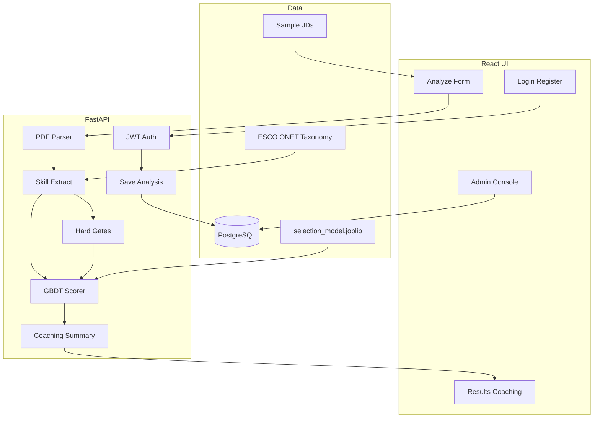

# Architecture

## Goals

Arawind v2 behaves like a small real product: accounts, persistence, admin ops, hard eligibility rules, and a calibrated selection model — while remaining runnable on a laptop via Docker Compose.

## High-level diagram

## Request lifecycle (`POST /api/v1/analyze`)

1. Optional JWT → attach `user_id` if present.
2. Read PDF bytes (never written to disk as a file).
3. Extract text (PyMuPDF) → structured profile (skills, education, projects, CGPA, locations).
4. Resolve JD from `role_id` and/or pasted text.
5. Lexical + semantic skill match → overlap / missing / weak.
6. Evaluate **hard gates** from JD + role metadata.
7. Build feature vector (skills + gate features) → model probability.
8. If any hard gate fails → `effective_selection_pct = 0`.
9. Rank learn-next skills, build roadmap, SHAP/importance explanations, coaching narrative.
10. If authenticated → persist JSON result in Postgres/SQLite.
11. Return `AnalyzeResponse`.

## Modules

| Path | Responsibility |
|------|----------------|
| `app/api/routes/auth.py` | Register, login, `/me` |
| `app/api/routes/analyze.py` | Analyze, what-if, history |
| `app/api/routes/admin.py` | Stats, users, analyses |
| `app/services/hard_gates.py` | CGPA, exp, location, degree, work-auth |
| `app/services/summary.py` | Strengths / improvements / blockers |
| `app/services/scorer.py` | Model load + inference |
| `app/db/models.py` | `User`, `Analysis` |
| `ml/train.py` | Heavy GBDT training |

## UI design system

Inspired by 2025–2026 SaaS “calm density” patterns (Linear / Stripe style restraint):

- **Display:** Fraunces (editorial serif for product voice)
- **UI:** IBM Plex Sans (large x-height, tabular-friendly)
- **Metrics:** IBM Plex Mono
- Light warm paper background, single green accent, minimal chrome, progressive disclosure on results

## Persistence policy

| Mode | Behavior |
|------|----------|
| Guest | Ephemeral response only |
| Signed-in user | Analysis JSON stored; visible in admin |
| Admin | Read users/analyses; toggle user active |

PDF binaries are **not** stored — only derived JSON.
